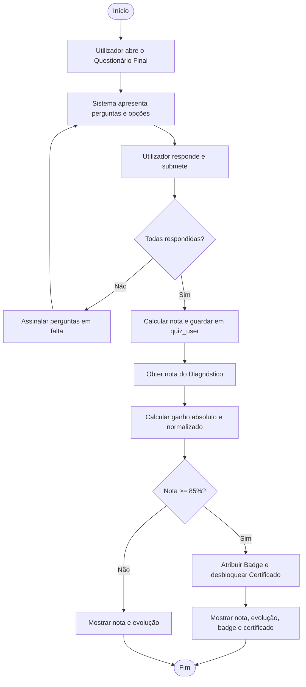

# Caso de Uso: Responder a Questionário Final

## 1. Metadados

|         Campo          |            Detalhe             |
| **ID**                 | `UC_005` (`US_A005`)           |
| **Nome**               | Responder a Questionário Final |
| **Ator Principal**     | Utilizador Registado           |
| **Atores Secundários** | Sistema                        | 

| **Objetivo** | Permitir que o utilizador responda ao questionário final após concluir um recurso formativo, registando a classificação, calculando a evolução face ao diagnóstico e atribuindo badge/certificado se atingir a nota mínima. 

| **Pré-condições** | 
• Utilizador autenticado.
• Utilizador inscrito no recurso formativo.
• Questionário de diagnóstico do recurso já respondido.
• Conteúdos/níveis do recurso concluídos. 

| **Pós-condições** | 
• Classificação (`grade`) e data (`grade_date`) guardadas na tabela `quiz_user`.
• Evolução da aprendizagem calculada (ganho absoluto e normalizado).
• Badge e certificado atribuídos ao perfil se a nota for $\ge 85\%$. 

---

## 2. Cenário de Sucesso Principal

1. O utilizador seleciona a opção para iniciar o **Questionário Final** do recurso.

2. O sistema valida as pré-condições e apresenta as perguntas (`questions`) e respetivas opções de resposta (`answers`).

3. O utilizador seleciona uma resposta para cada pergunta.

4. O utilizador submete o questionário.

5. O sistema verifica se todas as perguntas foram respondidas, compara as respostas com as opções corretas (`answers.correct = 1`) e guarda a nota (`grade`) e a data/hora (`grade_date`) na tabela `quiz_user`.

6. O sistema vai buscar a nota do Questionário de Diagnóstico (`pré`) do mesmo recurso e calcula o ganho absoluto ($\text{pós} - \text{pré}$) e o ganho normalizado ($g = \frac{\text{pós} - \text{pré}}{\text{máximo} - \text{pré}}$).

7. O sistema verifica se a nota final é igual ou superior a $85\%$:
   * **Se $\ge 85\%$:** Atribui o *badge* do recurso (`resources.badge_url`) e desbloqueia o certificado no perfil do utilizador.
   * **Se $< 85\%$:** Não atribui *badge* nem certificado.

8. O sistema mostra o resumo com a nota final, a comparação com o diagnóstico e, caso tenha atingido os $85\%$, a opção para descarregar o certificado. O utilizador fecha o resumo e volta à página do recurso.

---

## 3. Fluxograma

